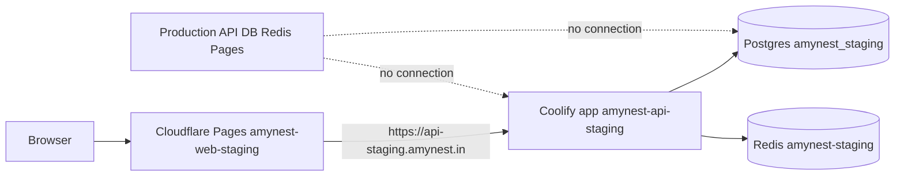

# Staging architecture

**Status:** `READY FOR HUMAN SETUP`  
**Date:** 15 November 2026  
**Not deployed.** Production Coolify, Cloudflare Pages project `amynest-web`, production Postgres, production Redis, Ads, and billing were not changed.

## Current production (unchanged)

| Plane | Identity |
|---|---|
| Web | Cloudflare Pages project `amynest-web`, `www.amynest.in` |
| API | Coolify on `188.245.208.126`, public origin `https://ik6ml2uhw6op765lo14wn5m3.188.245.208.126.sslip.io` |
| Database | Coolify Postgres host `tcl9udyxcuq2zu598ebj0pfu`, database `postgres` |
| Redis | Coolify Redis host `g7jotufnm43n4au4e8n6x946` |
| Deploy workflow | `.github/workflows/deploy-production.yml` only |

Local `amynest_dev` on `127.0.0.1` is development scratch. It is not staging.

## Staging shape

| Resource | Name | Host |
|---|---|---|
| Web | Cloudflare Pages `amynest-web-staging` | `staging.amynest.in` |
| API | New Coolify application `amynest-api-staging` | `api-staging.amynest.in` |
| Postgres | New Coolify database `amynest-staging-db` | private Docker hostname, database `amynest_staging` |
| Redis | New Coolify key-value `amynest-staging-redis` | private Docker hostname |
| Firebase | New project, not `amynest-836ff` | authorized domain `staging.amynest.in` |
| RevenueCat | Test Store / sandbox app only | webhook `https://api-staging.amynest.in/api/subscription/webhook` |

Use the existing Coolify VPS only if it has spare capacity. Do not attach staging to the production application, volume, or env group.

## Sizing and cost

Expected extra footprint on the current VPS: about 2 GB RAM and 10 GB disk.

| Service | Size |
|---|---|
| Staging Postgres 16 | 1 GB RAM, 10 GB volume, `max_connections` 40 |
| Staging Redis 7 | 128 MB, `maxmemory-policy noeviction` |
| Staging API | 1 GB RAM, one instance |
| Staging worker | Off until Redis is proven separate |

Incremental cash cost is zero if that headroom already exists. If it does not, resize the VPS. Do not free RAM by pointing staging at production Postgres or Redis. Firebase Spark, a RevenueCat Test Store, and one extra Cloudflare Pages project stay on the current plans. DNS stays in the existing `amynest.in` zone.

## Isolation already in the repo

These do not create infrastructure:

- `AMYNEST_ENV=staging` is a real profile. Unset `AMYNEST_ENV` with `NODE_ENV=production` remains production.
- Staging boot exits unless `DATABASE_URL` is database `amynest_staging`, the host is not a known production host, and `API_PUBLIC_URL` is `https://api-staging.amynest.in`.
- A staging API URL with any other `AMYNEST_ENV` also exits.
- A browser on `staging.amynest.in` calls `https://api-staging.amynest.in` even if the bundle was built as production.
- `.github/workflows/staging-isolation-check.yml` is manual and does not deploy. `.github/workflows/deploy-production.yml` was not edited.

## Analytics

Staging events live only in `amynest_staging`. The staging RevenueCat webhook secret is a different value from production. Sandbox purchases must use a Test Store key (`test_` prefix), not the `appl_` public key currently in local `.env`. Migration `0052` is not applied.
